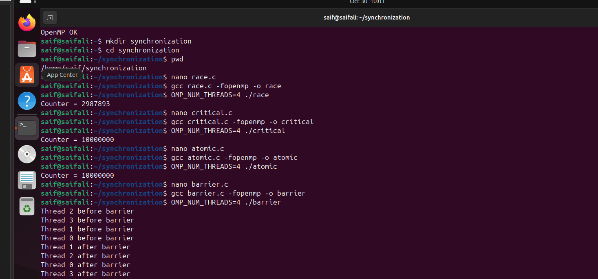
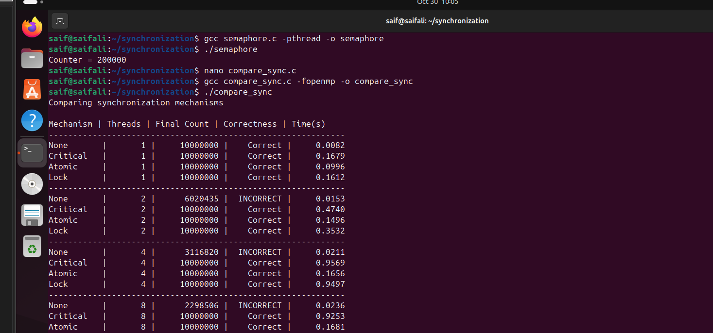
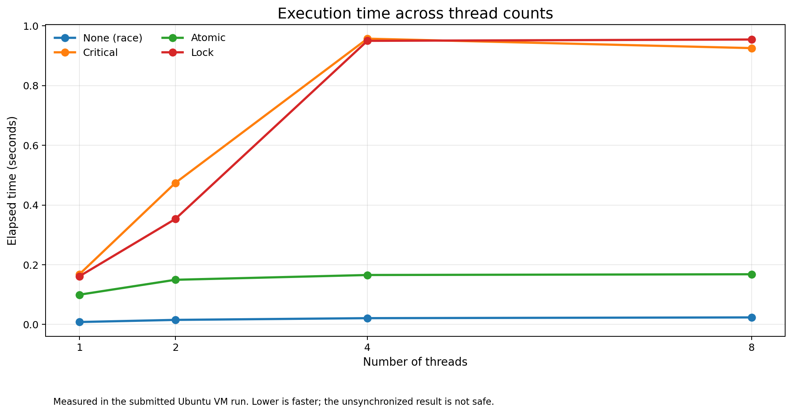
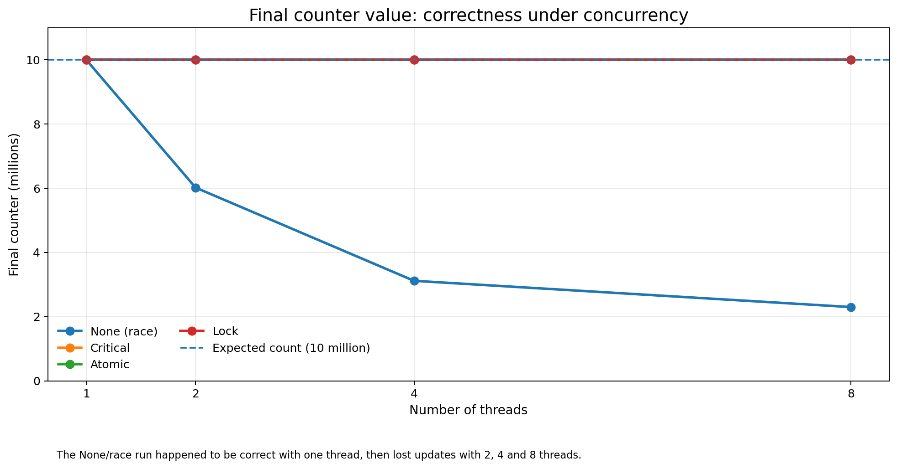
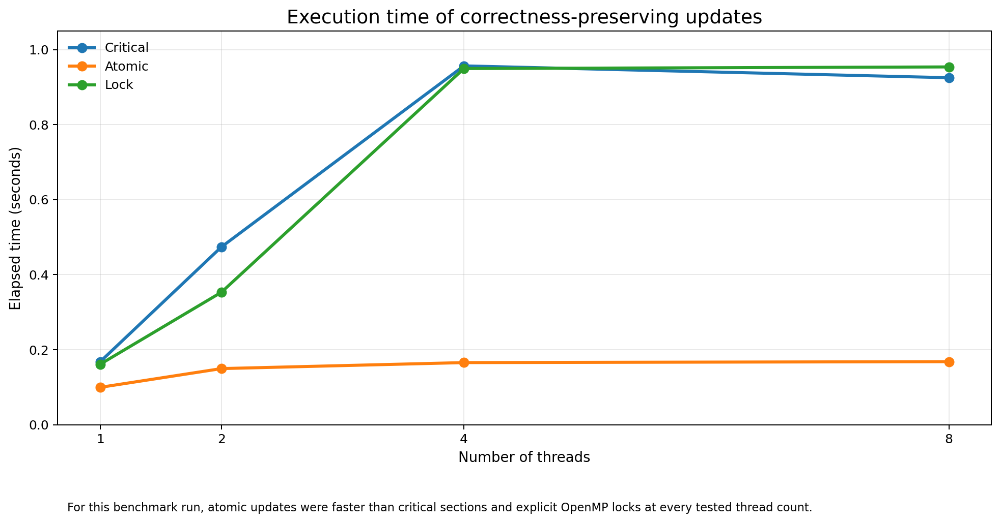

<div align="center">
  

  <p><strong>Experiment 5 · Parallel Programming · C / OpenMP / POSIX Threads</strong></p>
  <p>
    
    
    
    
  </p>
  <p><em>A practical comparison of correctness, execution time, and scalability when multiple threads update shared data.</em></p>
</div>

---

## Overview

This experiment studies synchronization mechanisms used by shared-memory parallel programs. A shared counter is updated by multiple threads using different approaches, and the results are compared across **1, 2, 4, and 8 threads**.

The implementation covers:

- An intentionally unsynchronized update to demonstrate a **race condition**.
- OpenMP **critical sections**, **atomic operations**, and **locks**.
- An OpenMP **barrier** to coordinate thread phases.
- A POSIX **binary semaphore** to protect a shared counter.
- A benchmark that records the final counter, correctness, and elapsed time.

> **Key result from the captured run:** atomic updates produced the expected count at every tested thread count and were faster than the critical-section and lock versions in this particular VM run. The unprotected counter lost updates at 2, 4, and 8 threads.

## Experiment objectives

1. Observe how concurrent access to shared data can cause lost updates.
2. Apply synchronization to ensure correct shared-counter updates.
3. Understand the difference between mutual exclusion and phase synchronization.
4. Compare elapsed time across multiple thread counts.
5. Discuss the trade-off between correctness, performance, and scalability.

## Environment

| Component | Captured / used configuration |
|---|---|
| Virtualization | VMware Workstation |
| Guest operating system | Ubuntu virtual machine |
| Compiler | GCC 13.3.0 |
| Parallel programming | OpenMP (`-fopenmp`) |
| Threading API | POSIX Threads (`-pthread`) |
| Semaphore API | POSIX unnamed semaphore (`<semaphore.h>`) |
| Benchmark workload | 10,000,000 counter increments per strategy |
| Thread counts | 1, 2, 4, and 8 |

The terminal capture confirms GCC **13.3.0** and successful OpenMP preprocessing (`OpenMP OK`). The exact Ubuntu point release and the VM's allocated vCPU/RAM were not recorded in the screenshots.

## Repository layout

```text
synchronization-mechanisms/
├── README.md
├── src/
│   ├── race.c
│   ├── critical.c
│   ├── atomic.c
│   ├── barrier.c
│   ├── semaphore.c
│   └── compare_sync.c
└── assets/
    ├── banner.png
    ├── screenshots/
    │   ├── program-execution.png
    │   └── benchmark-output.png
    └── graphs/
        ├── execution-time.png
        ├── final-counter.png
        └── protected-mechanisms-time.png
```

## Synchronization mechanisms at a glance

| Mechanism | How it works | What it demonstrates |
|---|---|---|
| None | Updates the shared counter without protection | A data race can lose updates |
| Critical section | Only one thread at a time enters the protected block | General mutual exclusion for a code block |
| Atomic operation | Makes a supported update indivisible | Lightweight synchronization for simple updates |
| Barrier | Every team thread must reach the barrier before any proceeds | Synchronization between phases of work |
| OpenMP lock | A thread explicitly acquires and releases a lock | Manual mutual exclusion |
| POSIX semaphore | `sem_wait()` acquires; `sem_post()` releases | Resource access control using a semaphore counter |

### Important distinction

A **barrier is not a mutex**: it coordinates when threads may continue, but it does not by itself protect a shared variable. A **critical section, atomic operation, lock, or semaphore** can protect shared updates when used correctly.

## Implementations and how to run

Open a terminal in the project directory. The source files are in `src/`.

### 1. Install the compiler toolchain

```bash
sudo apt update
sudo apt install build-essential -y
```

Check the compiler and OpenMP support:

```bash
gcc --version
echo '#include <omp.h>' | gcc -E -fopenmp -xc - > /dev/null && echo "OpenMP OK"
```

### 2. Race condition — no synchronization

**Source:** [`src/race.c`](src/race.c)

```bash
gcc src/race.c -fopenmp -o race
OMP_NUM_THREADS=4 ./race
```

The loop performs ten million increments without protecting `counter`. The final value is not guaranteed. It can occasionally equal the expected value, especially with one thread, but that does **not** make the unsynchronized program safe.

### 3. Critical section

**Source:** [`src/critical.c`](src/critical.c)

```bash
gcc src/critical.c -fopenmp -o critical
OMP_NUM_THREADS=4 ./critical
```

`#pragma omp critical` ensures that only one thread at a time executes the protected `counter++` block.

### 4. Atomic operation

**Source:** [`src/atomic.c`](src/atomic.c)

```bash
gcc src/atomic.c -fopenmp -o atomic
OMP_NUM_THREADS=4 ./atomic
```

`#pragma omp atomic` protects the supported increment operation. It is narrower than a critical section and is suitable for simple shared-variable updates.

### 5. Barrier

**Source:** [`src/barrier.c`](src/barrier.c)

```bash
gcc src/barrier.c -fopenmp -o barrier
OMP_NUM_THREADS=4 ./barrier
```

Each thread prints a message before the barrier and another after it. All threads must reach `#pragma omp barrier` before any thread can continue beyond it. The order of thread IDs in the output can vary.

### 6. POSIX semaphore

**Source:** [`src/semaphore.c`](src/semaphore.c)

```bash
gcc src/semaphore.c -pthread -o semaphore
./semaphore
```

The program creates two POSIX threads. Each performs 100,000 protected increments. The semaphore is initialized to 1, so the expected result is:

```text
Counter = 200000
```

### 7. Benchmark — compare synchronization strategies

**Source:** [`src/compare_sync.c`](src/compare_sync.c)

```bash
gcc src/compare_sync.c -fopenmp -o compare_sync
./compare_sync
```

The benchmark tests **None, Critical, Atomic, and Lock** for 1, 2, 4, and 8 threads. `omp_get_wtime()` measures elapsed wall-clock time, and the result is checked against the expected count of 10,000,000.

## Captured terminal evidence

### Individual programs: race, critical, atomic, barrier, and semaphore

The screenshot records the successful compilation and execution commands. The observed outputs include a non-deterministic race result, correct 10,000,000 results for critical and atomic, the before/after barrier messages, and the semaphore result of 200,000.

<p align="center">
  
</p>

### Benchmark output

This is the captured benchmark run used for the results table and charts below.

<p align="center">
  
</p>

## Measured benchmark results

**Expected correct count:** 10,000,000 increments per strategy.

| Mechanism | Threads | Final count | Correctness | Time (s) |
|---|---:|---:|---|---:|
| None | 1 | 10,000,000 | Correct in this run | 0.0082 |
| Critical | 1 | 10,000,000 | Correct | 0.1679 |
| Atomic | 1 | 10,000,000 | Correct | 0.0996 |
| Lock | 1 | 10,000,000 | Correct | 0.1612 |
| None | 2 | 6,020,435 | Incorrect | 0.0153 |
| Critical | 2 | 10,000,000 | Correct | 0.4740 |
| Atomic | 2 | 10,000,000 | Correct | 0.1496 |
| Lock | 2 | 10,000,000 | Correct | 0.3532 |
| None | 4 | 3,116,820 | Incorrect | 0.0211 |
| Critical | 4 | 10,000,000 | Correct | 0.9569 |
| Atomic | 4 | 10,000,000 | Correct | 0.1656 |
| Lock | 4 | 10,000,000 | Correct | 0.9497 |
| None | 8 | 2,298,506 | Incorrect | 0.0236 |
| Critical | 8 | 10,000,000 | Correct | 0.9253 |
| Atomic | 8 | 10,000,000 | Correct | 0.1681 |
| Lock | 8 | 10,000,000 | Correct | 0.9541 |

**Separate standalone race-program observation:** the earlier 4-thread run printed `Counter = 2987893`. That is a separate execution from the benchmark's 4-thread `None` result (`3,116,820`). Race-condition values can differ between runs because thread scheduling and interleaving are not deterministic.

## Performance graphs

### 1. Elapsed time across all four strategies

This graph uses the exact elapsed times captured from the benchmark. The unprotected version is fast in this run, but its incorrect results make it unsuitable as a correct solution.

<p align="center">
  
</p>

### 2. Final counter value and correctness

The expected count is 10 million. Critical, Atomic, and Lock reached that target for every tested thread count. The unprotected counter fell below the target as thread count increased beyond one in this run.

<p align="center">
  
</p>

### 3. Protected update strategies

Removing the unprotected version from the time graph makes the comparison among correct update strategies easier to read. In this captured run, Atomic was the fastest of the three protected approaches at 2, 4, and 8 threads, and also at 1 thread.

<p align="center">
  
</p>

## Observations and interpretation

1. **Race condition:** The unprotected counter was correct with one thread in this run, but incorrect at 2, 4, and 8 threads. The standalone four-thread run also produced a different incorrect count. This variability is characteristic of a race condition.
2. **Critical section:** The critical version produced the expected count in every benchmark configuration. Its measured time increased substantially when more threads contended for the same protected block.
3. **Atomic operation:** The atomic version produced the expected count at every thread count and had the lowest measured time among the protected update approaches in this run.
4. **Lock:** The explicit OpenMP lock also produced the expected count, but its measured elapsed time was close to the critical-section version at 4 and 8 threads.
5. **Barrier:** The barrier output demonstrates phase coordination: no thread proceeds beyond the barrier until all team threads have reached it.
6. **Semaphore:** The binary semaphore protected the shared counter, and the two-thread program produced the expected value of 200,000.

### What the results do — and do not — establish

- These are **one captured run** on a virtual machine, not universal performance guarantees.
- Timing can change with host CPU load, VM vCPU allocation, compiler settings, and thread scheduling. Repeated runs and averaging would provide a stronger performance study.
- A race-condition run that happens to print 10,000,000 is still not safe. Correctness must not depend on a lucky schedule.
- The benchmark compares four counter-update strategies. Barrier and semaphore are demonstrated by separate programs, not included in the benchmark timing table.

## Quick command reference

Run from the repository root:

| Program | Compile | Execute |
|---|---|---|
| Race | `gcc src/race.c -fopenmp -o race` | `OMP_NUM_THREADS=4 ./race` |
| Critical | `gcc src/critical.c -fopenmp -o critical` | `OMP_NUM_THREADS=4 ./critical` |
| Atomic | `gcc src/atomic.c -fopenmp -o atomic` | `OMP_NUM_THREADS=4 ./atomic` |
| Barrier | `gcc src/barrier.c -fopenmp -o barrier` | `OMP_NUM_THREADS=4 ./barrier` |
| Semaphore | `gcc src/semaphore.c -pthread -o semaphore` | `./semaphore` |
| Comparison | `gcc src/compare_sync.c -fopenmp -o compare_sync` | `./compare_sync` |

## Conclusion

The experiment demonstrates that synchronization is essential when multiple threads access and update shared data. The unsynchronized counter can lose updates, while critical sections, atomic operations, locks, and semaphores provide safe coordination when used correctly. The barrier synchronizes execution phases rather than protecting a variable directly. In the captured benchmark, atomic operations provided the best balance of correctness and elapsed time for this simple shared-counter workload. The measured results also show that synchronization overhead and contention can affect performance as thread count increases.

---

<div align="center">
  <sub>Experiment 5 · Synchronization Mechanisms in Parallel Programs · Results transcribed from the submitted Ubuntu terminal screenshots.</sub>
</div>
